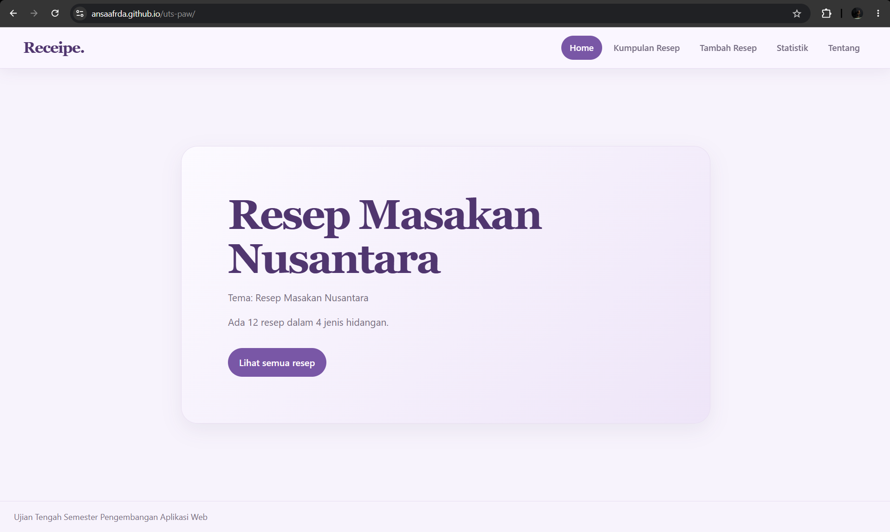

# Nama Aplikasi

Nama: Annisa Afrida
NIM: 124140121
Kelas: RA
Tema: Resep Masakan Nusantara
Deployment: https://ansaafrda.github.io/uts-paw/

## Fitur

- Beranda yang menampilkan judul aplikasi dan tema resep masakan nusantara.
- Ringkasan koleksi otomatis: jumlah resep dan jumlah jenis hidangan, dihitung dari data koleksi.
- Indikator "Memuat ringkasan..." selama data koleksi masih diambil.
- Halaman koleksi yang menampilkan semua resep, dapat diakses lewat tombol "Lihat semua resep".
- Navigasi antarhalaman tanpa reload memakai React Router.
- Tampilan bertema ungu yang konsisten di seluruh halaman dan menyesuaikan ukuran layar.

## Menjalankan secara lokal

cd app
npm install
npm run dev

## Konsep React yang dipakai

- *Komponen fungsional dan JSX*: aplikasi dibagi menjadi komponen seperti Layout, Beranda, Koleksi, dan KartuItem.
- *Props dan aliran data satu arah*: KartuItem menerima data lewat prop item; KotakPencarian menerima nilai pencarian dan fungsi onUbah sebagai callback ke komponen induk.
- *State dengan useState*: menyimpan nilai pencarian, kategori yang dipilih, isi form, dan pesan validasi.
- *Lifecycle dengan useEffect*: memuat data koleksi saat komponen pertama kali tampil dan menyinkronkan data dengan localStorage.
- *Context API*: KoleksiProvider membagikan data koleksi dan fungsi tambah/hapus ke seluruh halaman, diakses lewat useContext.
- *Custom hooks*: useKoleksi dan useLocalStorage memisahkan logika pengelolaan data dari tampilan agar bisa dipakai ulang.
- *Conditional rendering*: tampilan menyesuaikan kondisi data sedang dimuat, error, item tidak ditemukan, atau hasil pencarian kosong.
- *Rendering daftar*: data ditampilkan dengan .map() dan key yang unik.
- *Form dan event handler*: nilai input disimpan di state dan diperbarui lewat onChange, dengan validasi judul saat disimpan.
- *React Router*: Link untuk perpindahan halaman tanpa reload dan useParams untuk membaca parameter detail item.